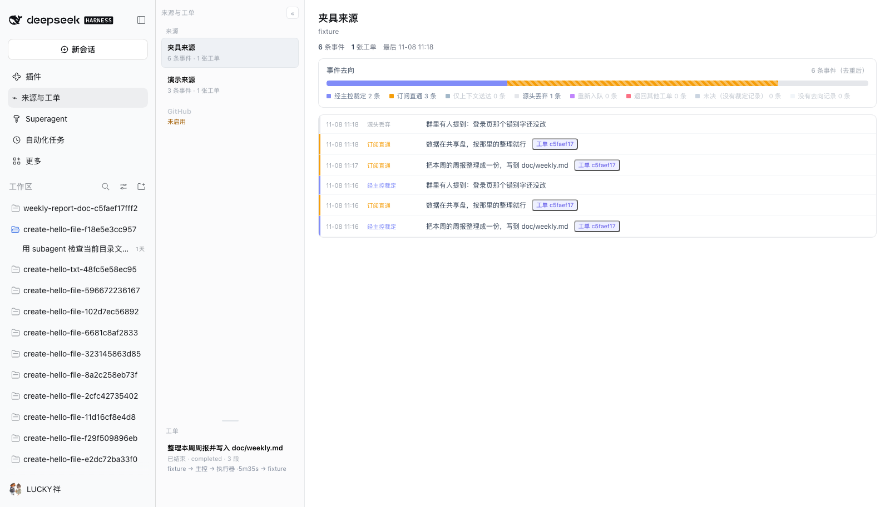
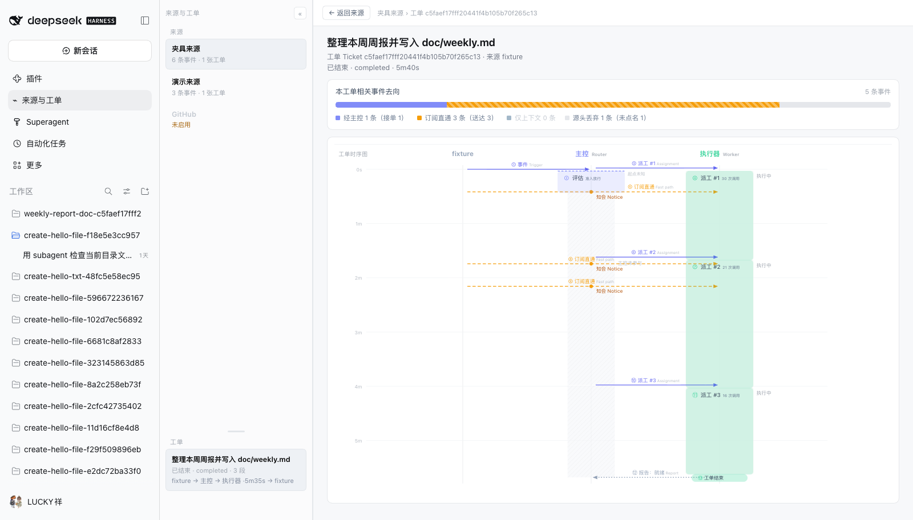

# dsh-agent-trace

**把 Super-agent 处理一条消息的全过程，展开成一张读得懂的时序图。**

DSH（DeepSeek Harness）的 `superagent` 配置会自己收消息、丢消息、建工单、派活、回话。这个插件把这些动作从库里翻出来，按真实时间画成一条链路：消息从哪来、为什么被丢掉、哪一次裁定生成了工单、执行器干了什么、子代理做了什么、最后回复了什么。

目标用户是想搞懂 Super-agent 内部机制的人——不是运维监控，也不是统计报表。





---

## 它解决什么

默认情况下，一个工单的内部过程散落在三处：`orchestrator.sqlite`（工单 / 裁定 / 去向 / 线程）、按会话存放的日志（模型请求、工具调用、想法）、以及宿主的内存状态。任何一处单独看，都只能看到片段。

这个插件做三件事：

1. **来源 → 事件 → 工单**，按系统真实顺序组织。落地页是来源页：每个来源收了多少、丢了多少、成单多少；事件从新到旧排列，每条都能点开看「它被怎么处理了」。
2. **事实与解释分开**。事件抽屉里，「事实」只写库里有的字段；按原因码翻译出来的话单独标为「解释」；上游没记的东西单列「没记录的事实」。**取不到就明说，不补全。**
3. **工单的完整时序**。主控 / 执行器泳道、评估块、派工、状态背景带、知会与回复箭头、子代理嵌套——一屏看完一条工单的来龙去脉。

它不是：

| 不是 | 因为 |
|---|---|
| 实时监控 / 告警 | 只做事后回看；页面打开时取一次，不做轮询 |
| 统计与趋势 | 那是 `dsh-context` 一类插件的事 |
| 抓包 / 埋点 | **纯读者**：只读现有库与日志，不采集、不建索引、不改上游 |

---

## 安装

### 前置条件

- DeepSeek Harness `>= 0.2.1-rc.0 < 0.3.0`，并已有一个可用的 `superagent` profile
- Node.js `22.19+` 或 `24+`
- 该 profile 已配置 `dsh-superagent`，且知道它的 `stateDir`（`orchestrator.sqlite` 所在目录）

### 1. 构建

```sh
cd plugin
pnpm install        # 或 npm install
npm run build       # 产出 lib/index.js（宿主侧）与 lib/client.js（客户端模块）
npm test            # 可选：单测
```

> 开发态可只装运行时依赖；构建需要 `tsdown` 与 `typescript`，已在 `devDependencies` 里声明。

### 2. 装进 profile

```sh
dsh plugin --profile superagent add "link:$PWD/plugin"
```

### 3. 配置

在 `~/.dsh/profiles/superagent/cordis.patch.yml` 里加一段：

```yaml
- insert:
    - id: dsh-agent-trace
      name: dsh-agent-trace
      config:
        # 必填：superagent 的 stateDir，插件只读这里的 orchestrator.sqlite
        stateDir: /absolute/path/to/superagent/state
        # 可选：把会话日志里的英文推理翻成中文；不配就直接显示原文
        translate:
          provider: deepseek-account
          model: deepseek-flash
```

`stateDir` 没配时插件会跳过自己（日志里记一条），不会影响宿主。

### 4. 打开

重启 profile → 侧边栏点 **来源与工单**。

---

## 界面

### 来源页（落地页）

左栏分上下两区（中间的横线可拖动，比例存在 localStorage）：

- **来源**：按最近活跃排序；装着的空来源也会列出（置灰）。
- **工单**：点任意工单直接进时序图。

主区是**事件去向比例带 + 事件流**：

- 比例带把该来源的全部事件按去向分色，图例可点——点一次只看这一类，再点恢复。
- 事件流按发生顺序倒排，「加载更早」走游标分页。
- 点任意事件行 → 右侧抽屉；挂了工单的事件，抽屉末尾有「打开工单时序图 →」。

### 事件抽屉

固定四段，边界清楚：

| 段 | 内容 |
|---|---|
| 事实 | 库里真有的字段：时间、发送者、线程、去向行、裁定与原因码、设置了版本快照、原文预览 |
| 为什么这样去 / 解释 | 由原因码查表得到的人话，**明确标注是解释**，不是记录 |
| 没记录的事实 | 上游确实没写下来的东西，逐条声明（例如「过滤只落原因码，没落当时的设置快照」） |
| 原文 / 关联工单 | 长文只回 200 字预览 + 总字数，点「展开原文」才取全文 |

### 工单时序图

覆盖在来源页之上的一层（左栏仍可点，换工单不用退出），顶部是「← 返回来源」+ 面包屑。

- 泳道：来源、主控（Router）、执行器（Worker）各成一列；多个来源就并排多列，子代理按需加列。
- 评估块：那一单的裁定、徽章（准入放行 / 规则拒绝 / 模型裁定）、事实行与规则评估。
- 派工块：每次派工一段，含报告状态、工具调用与返回、错误。
- 状态背景带：执行器列按「状态可能变化的时刻」切段，相邻同态合并。
- 箭头与节点：知会、回复、停止、不可用、投递失败、提问、重试、工单结束。
- 点任意元素（块、箭头、知会点、状态带、比例带段）都能打开对应的抽屉。

---

## 工作原理

```
sessionQuery ── 会话日志（多帧 zstd）
      │
orchestrator.sqlite（只读）── adapter ── domain ◄── presenter ── client(React+SVG)
      │                                      ▲
      └── service（join / 组装 / 路由）──────┘
```

- **单向依赖**：`client → presenter → domain ← adapter`。`domain` 与 `presenter` 不 import 任何 DSH 的东西。
- **上游私有契约只在一个文件里**：所有 sqlite SQL 都在 `src/adapter/superagent/db.ts`；其余代码只消费类型。
- **日志读取走宿主能力**：会话日志是多帧 zstd，文件直读只能解第一帧，必须走 `sessionQuery`。
- **点击才取**：打开面板只发 3 个请求（来源列表、工单摘要、事件首页）；点开工单**只多 1 个** `/chains/:id`。列表响应是纯摘要（实测 618 B，不含 span），服务端也不会为列表读会话日志。
- **失败隔离**：采集侧吞异常；展示侧面板根、工单覆盖层、事件抽屉各套一层错误边界，一处画不出来不影响其它部分。

### HTTP 接口（内部，供本插件的界面使用）

同源校验，除 `translate` 外只允许 `GET`；异常统一转 500 且只回错误摘要。

| 方法 | 路径 | 说明 |
|---|---|---|
| GET | `/agent-trace/health` | 插件自身健康快照（计数 / 耗时 / 存储探测） |
| GET | `/agent-trace/sources` | 来源列表（事件 / 工单 / 各去向计数） |
| GET | `/agent-trace/sources/:source/events?limit=&cursor=` | 事件分页，`limit` 夹到 1..200 |
| GET | `/agent-trace/sources/:source/events/:id` | 事件详情（事实 / 解释 / 未记录） |
| GET | `/agent-trace/sources/:source/events/:id/text` | 事件原文全文 |
| GET | `/agent-trace/chains?limit=&source=` | 工单摘要列表，`limit` 夹到 1..100 |
| GET | `/agent-trace/chains/:id` | 一条完整链路 + 去向 |
| GET | `/agent-trace/spans/:ticket/:span` | 一个时间块的内容 |
| GET | `/agent-trace/links/:ticket/:link` | 箭头 / 知会点 / 状态带的详情 |
| GET | `/agent-trace/texts/:ticket/:id` | 正文全文（默认只回预览） |
| POST | `/agent-trace/translate` | 可选：批量翻译（≤5 条、每条 ≤1200 字） |

---

## 隐私与安全

这是一个**只读**插件：不改上游数据、不写宿主配置、不发遥测。

- 对外只有本机 `127.0.0.1` 上的同源请求，跨源一律 403。
- 诊断日志**默认不写**：只有显式设置 `DSH_AGENT_TRACE_LOG=<文件路径>` 才落盘，且只记事件与计数，不记正文与标题。
- 错误响应与兜底文案只拼 `error.message`（截 200 字），不回栈、不回对象。
- 健康接口与日志一样，只记计数与耗时，不记路径参数。
- 模型翻译是可选项：不配 `translate` 就没有任何模型调用；配了也只送展示用的短文本，结果按文本哈希缓存在内存里。

---

## 已知限制

如实列出，别当 bug 意外：

| 限制 | 说明 |
|---|---|
| 500 节点的可读性 | 帧率达标（实测 59.9 fps、渲染 25–35 ms），但画布硬上限 1200 px 内 500 个节点会纵向叠成一列、标签互相压住。「过密时合并/折叠」是产品决策，未做 |
| 重复消息不留痕 | 上游在入库前按事件 id 去重，命中直接返回、不写任何行；插件只读库，无从观测。抽屉里会声明这一点 |
| 过滤事件的配置来源 | `filtered` 只落原因码，不落设置快照；只能声明「没有记录」，不猜 |
| 评估开始时刻 | 上游没落库，评估块从 `decision.at` 起画并标为近似 |
| 回复 / 知会箭头 | 依赖日志里真有的 `orchestrator_ack` / `orchestrator_reply`，且来源有回复通道；缺一就不画 |
| 刷新 | 页面打开时取一次快照；不做实时刷新或轮询 |
| 暗色主题 | 暂不支持 |
| 桌面端 | 未验证（web 端为已验证形态） |

---

## 开发

```sh
cd plugin
npm run typecheck                 # tsc --noEmit
npm test                          # node --test tests/*.test.ts
node node_modules/tsdown/dist/run.mjs   # 构建
```

- 单测当前 **232/232**（见 `npm test` 的 `ℹ pass` 汇总行）。
- E2E：`node tests/e2e/align.mjs "<带 token 的实例 URL>"`，对运行中的实例逐元素点开校验；另有一个不依赖真实数据的隔离页 `tests/e2e/harness.mjs`（500 节点、错误兜底、抽屉标签）。
- 客户端产物**必须是 DSH 的模块封装**（`window.__ModuleLoader__.load`）；输出普通 ESM 会让整个 Web UI 启动失败。

```
src/
├── domain/     纯类型（唯一真相，零外部依赖）
├── adapter/    上游 sqlite 契约、会话日志读取、形状翻译
├── service/    join 规则、详情组装、分类器、路由、健康
├── presenter/  列 / 块 / 箭头 / 时间窗换算（纯函数）
└── client/     React + SVG（来源页、抽屉、覆盖层时序图）
```

### 文档

仓库 `doc/` 下有完整的设计与规格文档，改界面前先看：

| 文档 | 内容 |
|---|---|
| `05-链路环节与元素规格.md` | **权威**：链路环节全景、元素模型、抽屉内容 |
| `03-界面设计.md` / `04-实现规格.md` | 界面形态 / 数据契约与边界 |
| `07-抽屉内容规格.md` | 抽屉文案模板 |
| `09-工作计划.md` | 里程碑、门禁、性能实测、踩坑记录 |
| `10-B14-来源页方案.md` | 来源页 / 覆盖层 / 事实三分 / Esc 栈的决策与取舍 |

---

## 状态与许可

- 开发进度：M0–M4 完成（数据层、垂直切片、完整形态、工程化）；**尚未发布到 npm / 插件市场**。
- 许可：MIT（见 `package.json`）。
